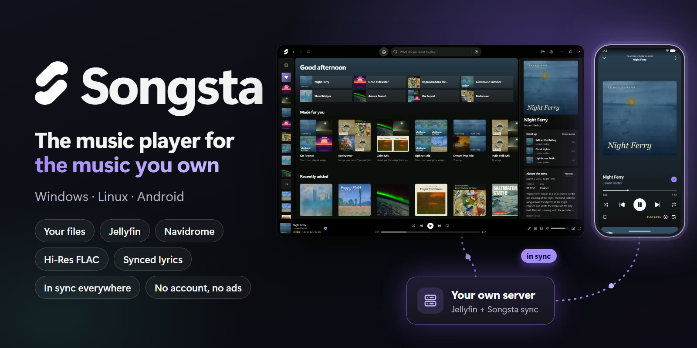
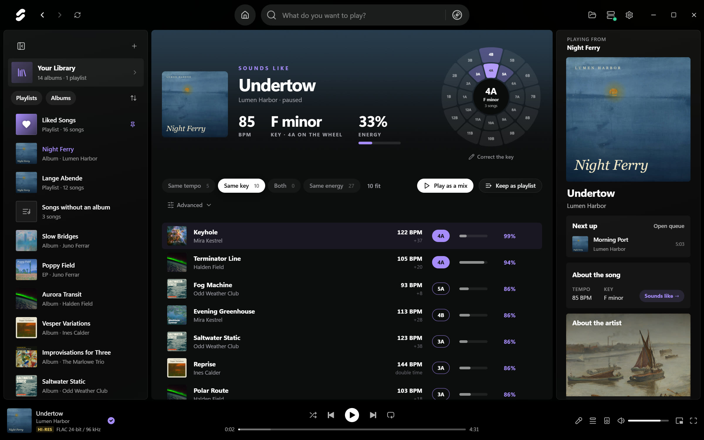
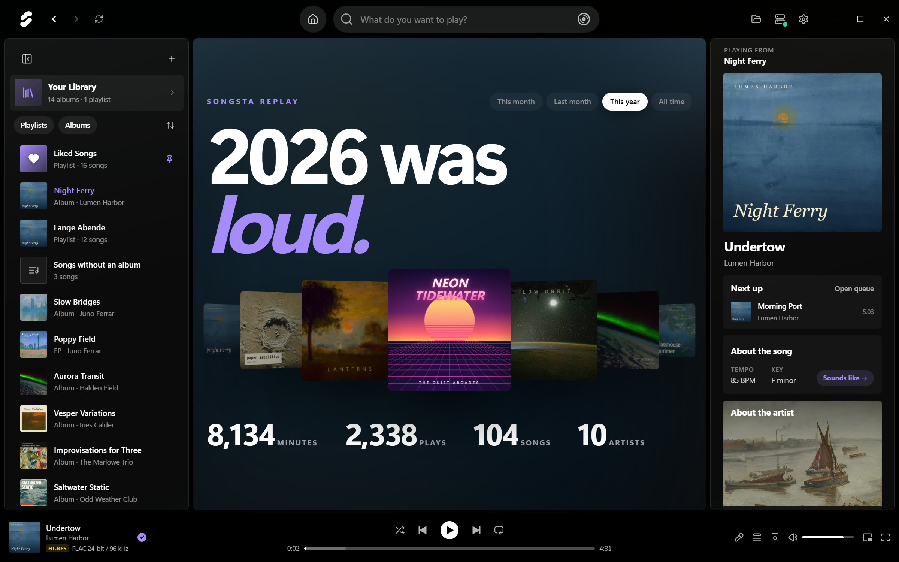

<p align="center">
  
</p>

<h1 align="center">Songsta: a music player for the music you own</h1>

<p align="center">
  <b>The feel of a streaming app, for your own collection.</b><br>
  Your files, Jellyfin and Navidrome in one library on Windows, Linux and Android: Hi-Res FLAC, synced lyrics, mixes from your own listening and the speakers at home. Free and open source, no account, no ads.
</p>

<p align="center">
  <a href="https://github.com/steggi-bernd/Songsta/releases/latest/download/Songsta-Setup.exe"></a>
  <a href="https://github.com/steggi-bernd/Songsta/releases/latest/download/Songsta-amd64.deb"></a>
  <a href="https://github.com/steggi-bernd/Songsta/releases/latest/download/Songsta-x86_64.AppImage"></a>
  <a href="https://github.com/steggi-bernd/Songsta/releases/latest/download/Songsta.apk"></a>
</p>

<p align="center">
  <a href="https://github.com/steggi-bernd/Songsta/releases/latest"></a>
  <a href="LICENSE"></a>
  <a href="https://apps.obtainium.imranr.dev/redirect?r=obtainium://add/https://github.com/steggi-bernd/Songsta"></a>
</p>

<p align="center">
  <a href="https://steggi-bernd.github.io/Songsta/">Website</a> ·
  <a href="#install">Install</a> ·
  <a href="docs/GUIDE.md">Full guide</a> ·
  <a href="https://github.com/steggi-bernd/Songsta/releases">Releases</a>
</p>

## Why Songsta

Streaming apps got a lot right: a Home page with mixes, artist pages, a real queue, one stream that moves between your devices. Songsta brings that to the music you own, built only from your own files and servers.

- **One library from everywhere.** Local folders, Jellyfin, Navidrome and any Subsonic server side by side. A song you have twice is listed once and plays from your disk first.
- **Made for good files.** FLAC up to 24-bit/192 kHz, and the player bar shows what really plays. Volume leveling, crossfade and an equalizer with AutoEQ headphone corrections.
- **Finds what sounds alike.** *Sounds like* matches your songs by tempo, key and energy, on the Camelot wheel DJs use, and mixes play in an order that flows.
- **Your listening, told back.** Mixes made from what you play, smart playlists, and *Replay*: your month or year as a story.
- **On your phone too.** The Android app plays your server and your folders, with downloads for when there's no connection.
- **One stream on every device.** A small service next to Jellyfin keeps playlists and where you stopped in sync, and one device steers another, like Spotify Connect.
- **Speakers at home.** UPnP/DLNA receivers, Chromecast and Nest speakers: one press moves the music, several play along.
- **Yours.** No account, no ads, no analytics, and every outside service it may talk to listed in its settings, yours to switch off.



## What it does

| | |
|---|---|
| **Library** | Local folders watched as they change, Jellyfin, Navidrome and Subsonic servers. Duplicates become one song, server songs can be kept offline, and an album editor and a library check fix messy tags without touching your files. |
| **Sound** | MP3, AAC, FLAC, WAV, Ogg and Opus directly; AIFF, ALAC, WMA, WavPack, APE and DSD through FFmpeg. ReplayGain leveling, a 10-band or parametric EQ with AutoEQ, crossfade, Automix and gapless albums. |
| **Discover** | Home with *Made for you* mixes, smart playlists by genre, year, plays, tempo, key or energy, *Sounds like* for any song, and *Replay*. |
| **Lyrics** | Synced lyrics from your files, your server or LRCLIB, search by a line you remember, and a full-screen Now Playing with a visualizer that moves with the music. |
| **Queue** | Drag to reorder, *Add to queue* plays first come first played, shuffle goes one way, and a song can branch off into the rest of its list. |
| **Devices** | One stream across your computers and phones; receivers, Chromecast, Google TV and Nest speakers, alone or in groups. |
| **Spotify** | Your Liked Songs and playlists come over in their order, with a shopping list of what's missing. |
| **Languages** | English and German. |



Every feature in detail, with more pictures: **[the full guide](docs/GUIDE.md)**.

> [!NOTE]
> The screenshots show a **made-up demo library**: artists, songs, lyrics and bios were invented for them, and the covers are public-domain paintings and NASA photographs ([credits](docs/screenshots/CREDITS.md)). The app around them is the real build.

## Install

Everything is on the [Releases page](https://github.com/steggi-bernd/Songsta/releases/latest). The desktop app stands on its own; the phone app and the sync service build on your Jellyfin server.

**Windows 10 / 11 (64-bit):** run `Songsta-Setup.exe`. It isn't code-signed, so SmartScreen asks once: *More info → Run anyway*. Songsta updates itself from then on. For AIFF, ALAC, WMA, WavPack, APE and DSD, add FFmpeg with `winget install ffmpeg`.

**Linux (64-bit):** the `.deb` for Debian, Ubuntu, Mint and their relatives (it brings FFmpeg along), the AppImage for any other distribution.

```bash
sudo apt install ./Songsta-amd64.deb
```

```bash
chmod +x Songsta-x86_64.AppImage && ./Songsta-x86_64.AppImage
```

AppImages need FUSE 2 (`libfuse2t64` on Ubuntu 24.04 and later); where one stops at start with a message about the "SUID sandbox helper", take the .deb.

**Android 7 or newer (64-bit):** open `Songsta.apk` on the phone. It isn't on a store, so Play Protect may ask once: *More details → Install anyway*. The app offers its own updates, or follow them with [Obtainium](https://apps.obtainium.imranr.dev/redirect?r=obtainium://add/https://github.com/steggi-bernd/Songsta). It's signed with Songsta's own key, SHA-256 `abe89dfcdab384e4ddb238ef03dc6b36a6140900aa83d03f2e433fa5a6fc45d2`.

**Sync service (optional):** playlists, the order of Liked Songs, where you stopped, your listening history and devices that steer each other, the same everywhere. A Docker container next to Jellyfin, for amd64 and arm64 (a Raspberry Pi too), from `songsta-sync.zip`:

```bash
JELLYFIN_NETWORK=<network Jellyfin is on> DATA_PATH=/path/for/its/data docker compose up -d
```

The apps find it by themselves and sign in with your Jellyfin login. [sync-server/README.md](sync-server/README.md) covers updates and reaching it from outside your home. More on each platform: [the guide's install chapter](docs/GUIDE.md#install-in-detail).

## Build from source

You need [Node.js](https://nodejs.org/) (LTS) and Git.

```bash
git clone https://github.com/steggi-bernd/Songsta.git
cd Songsta
npm install
npm run dev        # Vite + Electron with hot reload
npm test           # unit tests
npm run dist:win   # installer: release/Songsta-Setup.exe
```

The phone app has its own instructions in [mobile/README.md](mobile/README.md). [CONTRIBUTING.md](CONTRIBUTING.md) has the project's conventions, [docs/ARCHITECTURE.md](docs/ARCHITECTURE.md) how the parts fit together.

## Privacy

- **No account, no sign-in, no ads, no analytics.** Your library, likes, playlists and listening history stay on your own devices, and on your own server if you run the sync service.
- **Passwords aren't stored:** Jellyfin keeps a session token (or your API key), Navidrome a salt/token pair, sealed by Windows or your Linux desktop's keyring.
- **You decide what goes online.** *Settings → Network & privacy* lists every outside service Songsta may use (open music databases, lyrics, the update check), what it sends and why. Allow them all, only your own servers, or pick; a log shows what was contacted.

## Credits and license

Songsta began as a fork of [ByTune](https://github.com/rishiteja21/ByTune) by [rishiteja21](https://github.com/rishiteja21), the open-source YouTube Music desktop app, itself a desktop port of the BitChord Android player, and was rebuilt into a player for your own collection. Like both, it is licensed under the **GNU GPL v3**, see [LICENSE](LICENSE).

Built with Electron, React, TypeScript, Tailwind CSS, Zustand and music-metadata, the phone app with Expo, React Native and Media3. Songsta is not affiliated with Spotify, Discord, Jellyfin or Navidrome.
