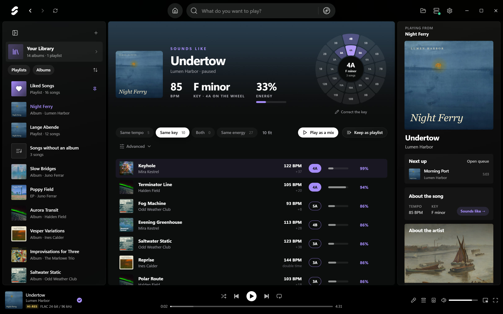
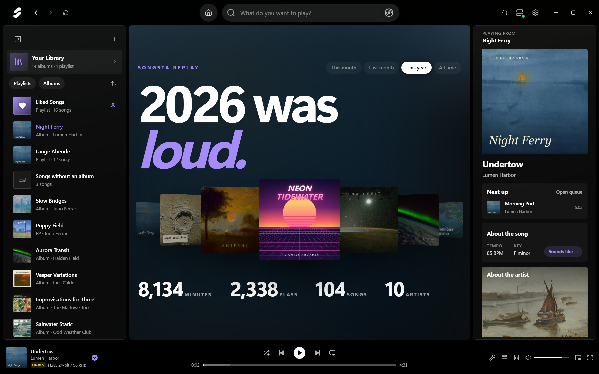
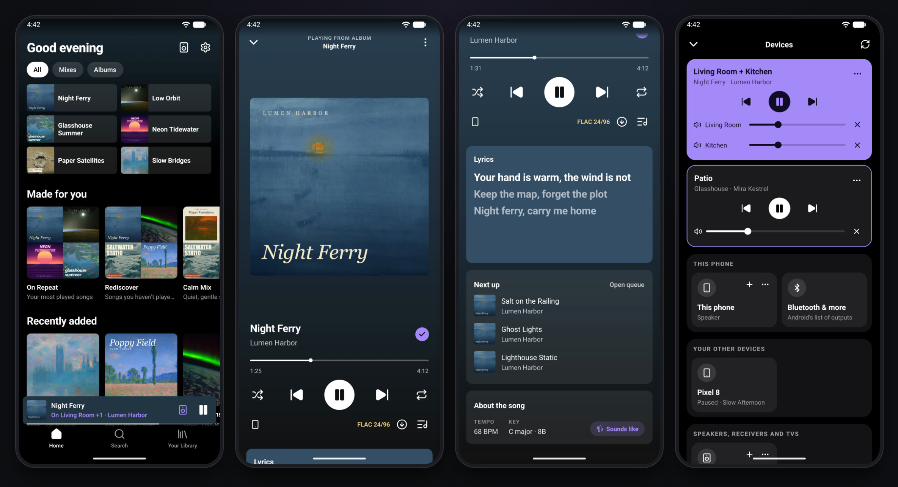
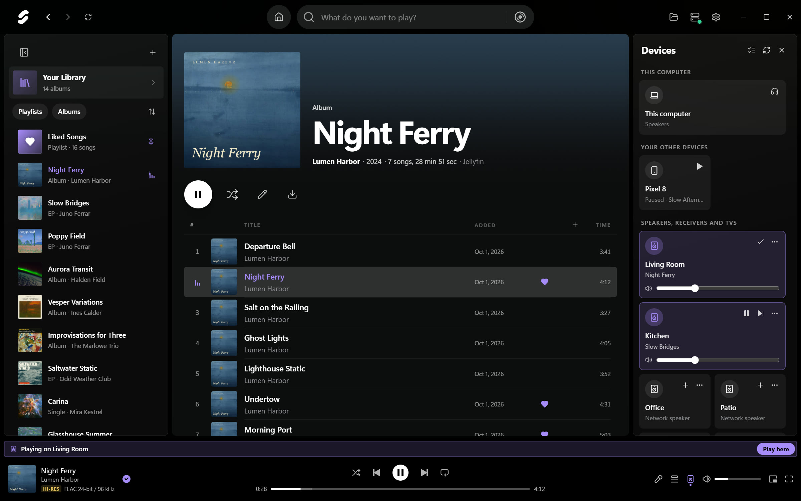

# The Songsta guide

Everything Songsta does, in detail. The short version, downloads and setup are in the [README](../README.md).

- [Your library](#your-library)
- [Sound](#sound)
- [Discover your music](#discover-your-music)
- [Lyrics and Now Playing](#lyrics-and-now-playing)
- [The queue](#the-queue)
- [Spotify import](#spotify-import)
- [On your phone](#on-your-phone)
- [The same on all your devices](#the-same-on-all-your-devices)
- [Your devices in one place](#your-devices-in-one-place)
- [Muting songs](#muting-songs)
- [Discord status](#discord-status)
- [Network and privacy](#network-and-privacy)
- [Install in detail](#install-in-detail)
- [Keyboard shortcuts](#keyboard-shortcuts)

The screenshots show a made-up demo library ([credits](screenshots/CREDITS.md)); the app around it is the real build.

## Your library

- **Local folders**, watched while the app runs: new, changed and deleted files show up without a rescan.
- **Jellyfin** (user name and password, or an API key) and **Navidrome or any Subsonic server**. Streams pass through a local proxy, so plain-http servers on your network work too. What's new on the server comes in at every start; the button on the server's page fetches it at once.
- **Duplicates become one song.** A song you have as a local FLAC and on your server is listed once, with its plays added up. It plays from the local file and streams only when that file can't be reached.
- **Offline copies of server songs.** *Download for offline* on a song, album or playlist fetches the original into a library folder. An album or playlist downloaded as a whole stays whole: what's added later, or didn't make it, comes by itself.
- **Unreachable songs are greyed out** (an unplugged drive, a server that doesn't answer) and come back by themselves.
- **Missing facts come from open databases:** covers and album names from MusicBrainz and the Cover Art Archive (iTunes Search as a fallback), album genres from MusicBrainz and Wikidata, artist bios and photos from Wikidata, Wikipedia and Wikimedia Commons. Your files are never rewritten.
- **Genres, tidied:** spellings fold together, names like "Singer/Songwriter" stay whole, genres sort into families, and songs without a genre take their album's.
- Credits like "Artist A, Artist B" count as two artists, each with their own page.

### Fix albums without touching your files

Tags aren't always right. The album editor (the pencil on an album page, or right-click an album in the library panel; on the phone, the ⋯ on an album page) lets you

- **give an album another name or picture**, with your files staying as they are,
- **add or remove artists** on an album, with one click back to what the tags say, and
- **merge albums** that show up as several (a "Disc 2", bonus tracks, one song with a different album artist), and separate them again.

Songs whose tags name no album gather under **Songs without an album** in the library panel. *Make an album…* puts them on one (title, artist, year and order) or on an album you already have. With the [sync service](#the-same-on-all-your-devices) these edits are the same on all your devices, made on whichever one.

**Library check** (*Settings → Library*) looks for the rest: artists written different ways, albums split into parts, songs you have twice, albums without a cover, year or genre, and songs without an album, with a fix wherever Songsta can make one itself.

## Sound

- **See what you hear:** the player bar shows *Hi-Res*, *Lossless* or *Lossy* with the codec and the bit depth and sample rate (or bit rate) of what actually plays.
- Plays MP3, AAC, FLAC up to 24-bit/192 kHz, WAV, Ogg Vorbis and Opus directly. AIFF, ALAC, WMA, WavPack, APE and DSD play through [FFmpeg](https://ffmpeg.org/), converted once into a cached 24-bit FLAC with full seeking.
- **Volume leveling** from ReplayGain tags, per song or per album, towards −18, −14 or −11 LUFS. It only ever turns loud songs down.
- **Equalizer:** ten bands, or a parametric EQ with [AutoEQ](https://github.com/jaakkopasanen/AutoEq) corrections for about 9,000 headphones, Equalizer APO import and the frequency response drawn live.
- Crossfade, Automix, skip silence, playback speed, and a volume slider that is actually quiet at the bottom.
- **Seamless albums:** live albums, DJ mixes and songs that run into each other play on without a gap or a crossfade.
- **Repeat one ends when you skip:** go to another song and the whole list repeats from there. A switch in Settings turns that off.
- **Media analysis:** tempo, key and energy of your songs, measured once in the background: local files with FFmpeg, server songs from a short stretch the server sends. It starts when you start it (*Settings → Library*, under *Media analysis*), and songs it can't measure are listed with the reason and *Try again*. With the sync service, the measurements and your key corrections reach your other devices, so a second computer doesn't measure again and the phone shows them too.

## Discover your music

- **Home**, built only from your library: a wall of your covers behind the greeting and your library's numbers, what plays now as a cover with Play/Pause beside the albums and mixes you played last, Liked Songs, what you played most this week, Downloads and Local Music, the albums that joined last, your playlists, your library by genre, your mixes (On Repeat, Rediscover, what you usually play at this time of day, Calm and Upbeat, one per big genre and decade, reshuffled daily) and your top artists.
- **Explore** the library as a grid with an A–Z rail to jump by letter; albums sorted by year get a timeline instead.
- **Album and artist pages** with play and shuffle, popular songs ranked by your own plays, the artist's songs you've liked, albums, singles & EPs, "appears on", your own numbers and the Wikipedia bio.
- **Song lists** with columns of your choice (album, date added, release date, genre, format, plays, tempo, key) beside the title and time. A click on a column's name orders the list by it, a grip widens it, dragging moves it. *Sort flowing* orders a playlist so each song leads into the next.
- **Smart playlists** that fill themselves from rules: genre or genre family, artist, year, date added, plays, last played, length, format, sample rate, bit depth, source, liked, tempo, energy and key, with an order (also *Flow*) and an optional limit. *Workout* and *Wind down* are ready-made.
- **Mixes that flow:** keys next to each other on the wheel, tempo changing gradually, an energy arc, an artist not twice in a row, and songs you skip less often.

### Sounds like

*Sounds like* (the button beside a song's facts in the right panel, or on an artist's page) finds the songs in your library that sound like one song, by the tempo, key and energy the media analysis measured.

- Four plain ways to match: same tempo, same key, both, same energy, each with how many songs fit. The rest (tempo window, key rule, genre families, only liked songs, nothing played today) waits under *Advanced*.
- **The Camelot wheel** DJs use, around the song's key. Turn it to another key and one song of yours in that key takes the song's place, with its tempo, key and energy and a play button, so you hear what the key sounds like; the matches aim there too. If the analysis heard the wrong key, *Correct the key* on the wheel.
- *Play as a mix* plays the matches in an order that flows; *Keep as playlist* saves them.
- *Often heard together* from your listening history, a *Mix for you*, and mixes by sound: late night, run, focus, sunlit, in this key.

### Replay

*Replay* (Settings → Your data) tells your listening back: this month, last month, this year or all time, slide by slide, with the wheel, a swipe or Page Up/Down. Your most played albums, the album of the period, five songs you couldn't stop, your prime time, the period's pulse, your weekdays, the faces of your top artists, what was new to you, genres, sound and sources, a listening calendar, and a ticket to end on. Every listen is below. With the sync service, Replay counts what all your devices played.

*Everything you heard* on Home opens the whole listening history as a page of its own: every play by day, newest first, with its cover. A click plays the song and goes on with what you heard before it; Play and Shuffle take the songs you heard, newest first.

## Lyrics and Now Playing

- **Synced lyrics, your own first:** a `.lrc` next to the file, lyrics embedded in the tags, or your Jellyfin server's. Otherwise online providers such as LRCLIB and KuGou; answers are cached on disk.
- **Search by lyrics:** a line you remember finds the song, among the lyrics already on this computer.
- **Full-screen Now Playing** (<kbd>N</kbd>) with cover, lyrics and queue, tinted by the cover's colours, or as a visualizer that moves with the music: each ray a band of the sound, the bass swelling the record.
- **Mini player:** an always-on-top picture-in-picture window.
- **On the taskbar:** the window's preview has previous, play/pause and next, on Windows.
- **With Windows, if you like:** *Settings → Startup & updates* opens Songsta with its window when you sign in.

## The queue

- **A real queue:** drag to reorder. *Add to queue* puts a song behind everything you asked for before it, first come, first played, in an area of its own above the rest of the list. A song you have in several places still plays only once.
- **Shuffle that goes one way:** it mixes what's coming, so the list you see is what plays, and *Previous* goes back to the song you really heard.
- **Branch off:** a song next, the rest of its list behind it, as a block with the list's name; its cross takes the whole branch back.

## Spotify import

Export your Liked Songs with [Exportify](https://github.com/watsonbox/exportify) (CSV) or take `YourLibrary.json` from Spotify's own data download, then open **Import from Spotify** in Liked Songs or Settings. Songsta sorts every song into three lists:

- **In your library:** songs you already have. *Add to Liked Songs* adds them in Spotify's order, newest first. After buying more, add again: new songs land in their place.
- **To check:** the title, length or artist spelling differs. Answer *Same song* or *Different*, or *Choose…* the right song yourself.
- **Missing, to buy:** your shopping list, to save as a spreadsheet or copy.

**Playlists** come over the same way: **+ → Recover a Spotify playlist** in the library panel, from Exportify's CSV or `Playlist1.json`. The playlist remembers what's missing: a song you buy later joins it by itself, in its place.

## On your phone

The Android app plays the music on your Jellyfin server and in folders you pick on the phone, laid out like the desktop app: Home with your mixes, Search with *Explore your library*, Your Library, album, artist and playlist pages. The lock screen, notification and headset buttons work.

- **Away from home:** give your server a second address (a tunnel or proxy) in the app's settings. The app takes the direct way at home and the other one anywhere else.
- **The player:** under it lie the lyrics, what comes next, and a card about the song with its tempo, key and *Sounds like*, with half a Camelot wheel you swipe to turn the key.
- **Your own files:** pick folders in Settings. A song your server has too stays one song and plays from the file; without a server the app works from the folders alone.
- **Swipes:** pull a song right to add it to the queue, hold it to branch off, pull it left to mute it.
- **Downloads** of songs, albums and playlists, also with the screen off, as the file itself or as a 192 kbps MP3; over mobile data only if you allow it. Without a connection the app opens from what it remembers.
- **Quality:** the player shows what really plays, gold for lossless; tap it to choose *Original*, *Compact* or *Automatic*.
- **Pull down on Home** to read everything again: sound lines play as a visualizer while the greeting tells what was read, line by line.
- **Replay** as a story of colourful slides; tap to go on, hold to pause.
- **Settings:** streaming quality, fades, skip silence, playback speed, autoplay, volume leveling, *Even out loud and quiet* for orchestras on headphones, a ten-band equalizer, lyrics, accent colour and more.

The app is young and has run in an emulator far more than on real phones, so please [open an issue](https://github.com/steggi-bernd/Songsta/issues) when something misbehaves. [mobile/README.md](../mobile/README.md) has more, and how to build it yourself.

## The same on all your devices

Which songs you like and how often they played go through your server's own favourites and play counts (*Server sync* in Settings). Everything else needs the small [sync service](../sync-server/README.md) next to Jellyfin: a Docker container without any music in it, signed in to with your Jellyfin login. With it, a playlist made on one device arrives on the others within moments, Liked Songs keep your order, muted songs stay muted, your library is organised the same everywhere (pins, sort, groups, album edits), Replay counts every device's plays, and the media analysis is shared.

**Without a sync service,** the desktop app can be one for your phones at home. Switch on *Phones at home* in Settings → Sync & devices, choose *Pair a phone*, and type the code it shows into the phone under Settings → Sync and devices → *Link to a computer*. Everything above then works between them while Songsta is open on the computer. A song only the computer has, a file of its own or one from its server, plays on the phone from the computer; one only the phone has plays on the computer from the phone, which stays awake for it with a note while it does. On Windows, Songsta offers the firewall rule for your own network that this needs.

There is one stream, like Spotify Connect: a device that isn't playing shows what another one plays and steers it. *This phone* or *This computer* under Devices brings the music over. Only *Start a second stream* on a device's tile lets each go its own way, until you end it. Its queue can be edited from several devices at once: each edit names the songs it means, also a song that's in the queue twice, and edits made at the same moment all stay.

## Your devices in one place

The speaker button next to the volume opens a small smart-home room for everything that can make sound:

- **One press moves the music:** to this device and its outputs, to your other computers and phones with Songsta, or to receivers and network speakers over UPnP/DLNA, Chromecast, Google TV and Nest speakers over Cast. It goes on from the same place in the song.
- **Several at once:** let other devices play along, each with its own volume, or give a device music of its own with its own queue while yours goes on.
- **Receivers and TVs:** a receiver still asleep is waited for; a Denon or Marantz goes off half a minute after the music has left it, unless you press *Keep on*; a paired Google TV goes off too, and brings its receiver along when music goes to it.
- **Local files and Windows' firewall:** when the firewall keeps a device out, Songsta offers a rule for your own network only.
- **Timing:** each device in a group fetches by itself; Songsta keeps them close, and *Fine-tune timing* moves one earlier or later in steps of 50 ms. A Cast group made in Google's own app is exact.

## Muting songs

Pull a song left on the phone, or choose *Mute song* in its menu on either app, and it's skipped in every album, playlist and shuffle. It plays only when you ask for it by name. The same way unmutes it.

## Discord status

Show what you're listening to on Discord, as *Listening to Songsta*: off until you switch it on under *Settings → Sync & devices*. Only the Discord app on your computer receives the title, artist and album; the cover is a public picture from iTunes or the Cover Art Archive, never your server's or your files'. You can use an application ID of your own from the [Discord Developer Portal](https://discord.com/developers/applications).

## Network and privacy

- **No account, no sign-in, no ads, no analytics.** Your library, likes, playlists and listening history stay on your own devices, and on your own server if you run the sync service.
- **Passwords aren't stored:** Jellyfin keeps a session token (or your API key), Navidrome a salt/token pair, sealed by Windows (on Linux, your desktop's keyring) through Electron's safeStorage.
- ***Settings → Network & privacy*** lists every outside service Songsta may use, with its purpose, what it sends and where to: the open databases above (paced to MusicBrainz's one request per second and cached), lyrics providers, Genius for what's known about a song, the AutoEQ index, GitHub once a day for the newest version, and, only if you switch it on, the animated canvas behind the player. Allow them all, only your own servers and home network, or pick; a log shows what was contacted, host and service only, kept in memory. The first start asks.
- **Your data folder** can move to another drive from the same page.

## Install in detail

### Windows

- `Songsta-Setup.exe` installs as **Songsta** and replaces an older ByTune Local (the app's name until November 2026; `com.bytune.local` stays its app id for that). It never replaces an installed original ByTune or shares its data.
- The installer is one page and one button; *Change…* takes it to another folder. At the first start Songsta asks where your music is: a folder, your own server, or both.
- Your data lives in `%APPDATA%\Songsta`. *Settings → Your data* exports and imports backups.
- **It updates itself:** a new version is fetched in the background and goes in when you close Songsta, or at once with *Restart now*.

### Linux

- The `.deb` puts Songsta in the app menu and installs FFmpeg along with it; the AppImage needs FFmpeg from your package manager.
- AppImages need FUSE 2: `libfuse2t64` on Ubuntu 24.04 and later (`libfuse2` before), `fuse-libs` on Fedora, `fuse2` on Arch. If one stops with a message about the "SUID sandbox helper", your system restricts Chromium's sandbox (Ubuntu does since 23.10): take the .deb, which sets up the AppArmor profile.
- Your data lives in `~/.config/Songsta`; server sign-ins are sealed by your desktop's keyring (GNOME Keyring, KWallet).
- Songsta tells you about a new version and links to it. Media keys work through MPRIS. Under Wayland the mini player can't stay on top.
- The Linux packages are built by GitHub Actions for every release; Songsta is developed and tested on Windows.

### Android

- For Android 7 or newer on a 64-bit phone. A new version installs over the old one.
- Signed with Songsta's own key, SHA-256 `abe89dfcdab384e4ddb238ef03dc6b36a6140900aa83d03f2e433fa5a6fc45d2` (`apksigner verify --print-certs Songsta.apk` shows it). Up to 1.5 it was the standard development key, which handed over to the new one, so updates install as before; Android 7 and 8 keep checking the old key.
- *Settings → This app* fetches a new version and hands it to Android, which asks before it installs. With *Automatic updates* on, it fetches by itself over Wi-Fi.
- The first start asks where your music is: a folder on the phone, your Jellyfin server, or both. Navidrome is the desktop app's only.

## Keyboard shortcuts

| Action | Keys |
|---|---|
| Play / pause | <kbd>Space</kbd> · media keys |
| Seek ±5 s | <kbd>←</kbd> / <kbd>→</kbd> |
| Previous / next song | <kbd>Shift</kbd>+<kbd>←</kbd> / <kbd>Shift</kbd>+<kbd>→</kbd> |
| Volume · mute | <kbd>↑</kbd> / <kbd>↓</kbd> · <kbd>M</kbd> |
| Shuffle · repeat | <kbd>S</kbd> · <kbd>R</kbd> |
| Queue · lyrics · Now Playing | <kbd>Q</kbd> · <kbd>L</kbd> · <kbd>N</kbd> |
| Search | <kbd>Ctrl</kbd>+<kbd>F</kbd> or <kbd>/</kbd> |
| Fold the library panel | <kbd>Ctrl</kbd>+<kbd>B</kbd> |
| Back / forward | the mouse's back and forward buttons |

Shortcuts never fire while you're typing in a text field. The apps speak English and German, following your system unless you choose under *Settings → Display*; another language is one more file in `src/locales`.
